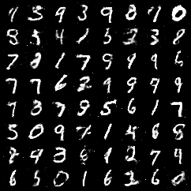
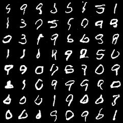
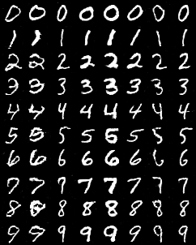
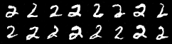
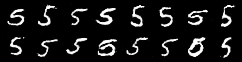
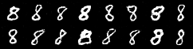

# GAN Zoo Mini

This repository has PyTorch reproductions of three classic GAN papers on MNIST. I write each model line by line to learn how it works.

The three models build on each other:

1. **GAN**: a generator and a discriminator (both MLP) play a minimax game. The generator learns to map noise `z` to images.
2. **DCGAN**: convolutional layers replace the MLP. The paper also gives rules for stable training (BatchNorm, ReLU in G, LeakyReLU in D, no BatchNorm on the G output layer and the D input layer).
3. **cGAN**: the generator and the discriminator both get the class label `y`. This lets you select the digit to generate.

All models train on MNIST (train and test sets together, 70,000 images of size 28 &times; 28). One training script trains all models. Use `--model` to select one.

## Models

| Model | Paper | Venue | File | G parameters | D parameters |
|:---:|:---:|:---:|:---:|:---:|:---:|
| GAN | [Generative Adversarial Nets](https://arxiv.org/abs/1406.2661) | NeurIPS 2014 | [`models/gan.py`](models/gan.py) | 566,800 | 533,505 |
| DCGAN | [Unsupervised Representation Learning with Deep Convolutional Generative Adversarial Networks](https://arxiv.org/abs/1511.06434) | ICLR 2016 | [`models/dcgan.py`](models/dcgan.py) | 423,489 | 22,081 |
| cGAN | [Conditional Generative Adversarial Nets](https://arxiv.org/abs/1411.1784) | arXiv 2014 | [`models/cgan.py`](models/cgan.py) | 473,825 | 30,209 |

The models do not copy each paper exactly. The differences are:

- **All models**: Adam (`lr=2e-4`, `betas=(0.5, 0.999)`) trains G and D. G minimizes `-log D(G(z))` instead of `log(1 - D(G(z)))`, as the GAN paper suggests.
- **GAN**: both networks use LeakyReLU, and G ends with `tanh`. The paper uses maxout in D and SGD with momentum.
- **DCGAN**: G uses nearest-neighbour upsampling and a 3 &times; 3 convolution instead of `ConvTranspose2d`. The networks are smaller than in the paper (64 and 32 channels), and the weights use the PyTorch default initialization.
- **cGAN**: the networks use the DCGAN layout, not the MLP of the paper. An `nn.Embedding` replaces the one-hot label. G concatenates a 16-dim label vector to `z`. D gets the label as a learned 28 &times; 28 map, which it concatenates to the image as a second input channel.

## Examples

Samples from the generator after 100 epochs, from a fixed batch of noise:

<table align="center">
  <tr>
    <th width="33%">GAN</th>
    <th width="33%">DCGAN</th>
    <th width="33%">cGAN</th>
  </tr>
  <tr>
    <td align="center" valign="top"><br><sub>MLP, 8 &times; 8 random samples</sub></td>
    <td align="center" valign="top"><br><sub>CNN, 8 &times; 8 random samples</sub></td>
    <td align="center" valign="top"><br><sub>Row <i>i</i>: digit <i>i</i>. Each column uses the same noise.</sub></td>
  </tr>
</table>

## Installation

1. Create and activate a conda environment:

   ```bash
   conda create -n gan python=3.12
   ```

   ```bash
   conda activate gan
   ```

2. Install PyTorch and torchvision. Select the command for your CUDA version on the [PyTorch website](https://pytorch.org/get-started/locally/). This project uses PyTorch `2.14.1` and torchvision `0.29.1`.

The training script needs a CUDA GPU. It keeps all 70,000 images on the GPU (220 MB). The generation script can also run on the CPU.

## Usage

Train a model first (see [Training](#training)). Then generate 64 images with the trained DCGAN:

```bash
python generate.py --model dcgan
```

The script reads `outputs/dcgan/generator.pth` and writes `outputs/dcgan/generated.png`.

For cGAN, use `--digit` to select the digit. Without `--digit`, column *i* of the 10 &times; 10 grid is digit *i*:

<table align="center">
  <tr>
    <th width="33%"><code>--digit 2</code></th>
    <th width="33%"><code>--digit 5</code></th>
    <th width="33%"><code>--digit 8</code></th>
  </tr>
  <tr>
    <td align="center"><br><sub><code>python generate.py -m cgan -d 2 -n 16</code></sub></td>
    <td align="center"><br><sub><code>python generate.py -m cgan -d 5 -n 16</code></sub></td>
    <td align="center"><br><sub><code>python generate.py -m cgan -d 8 -n 16</code></sub></td>
  </tr>
</table>

- Use `--seed` to get different images. The same seed always gives the same images.
- Use `--checkpoint` to load other weights, for example `outputs/dcgan_real0.9/generator.pth`.

## Options

| Argument | Type | Default | Description |
|:---:|:---:|:---:|:---:|
| `-m`, `--model` | string | `gan` | Model to use: `gan`, `dcgan` or `cgan`. |
| `-c`, `--checkpoint` | path | `outputs/<model>/generator.pth` | Path of the generator weights. |
| `-o`, `--output` | path | `outputs/<model>/generated.png` | Path of the output image. |
| `-n`, `--num` | integer | `64` (`100` for cgan) | Number of images. The grid has 8 columns (10 for cgan without `--digit`). |
| `-d`, `--digit` | integer | - | cgan only. Generate only this digit (`0` to `9`). |
| `-s`, `--seed` | integer | `0` | Random seed for the noise. |
| `-h`, `--help` | flag | - | Show the help message. |

## Training

The training script downloads [MNIST](https://yann.lecun.com/exdb/mnist/) to `data/` on the first run.

```bash
# Train the MLP GAN
python train.py --model gan
```

```bash
# Train DCGAN
python train.py --model dcgan
```

```bash
# Train cGAN
python train.py --model cgan
```

```bash
# Train DCGAN with one-sided label smoothing
python train.py --model dcgan --real-label 0.9
```

The script prints one line per epoch with `loss_D`, `loss_G`, `D(x)` and `D(G(z))`. `D(x)` and `D(G(z))` are the mean D scores on real and fake images. Values near `0.5` mean that G and D are balanced.

The script writes these files to `outputs/<model>/`:

- `epoch_XXX.png`: a grid of samples from fixed noise, every 5 epochs.
- `generator.pth` and `discriminator.pth`: the weights after the last epoch. `generate.py` reads `generator.pth`.

When `--real-label` is not `1.0`, the folder name gets a suffix (for example `outputs/dcgan_real0.9/`). This keeps the results of the default run.

| Argument | Type | Default | Description |
|:---:|:---:|:---:|:---:|
| `-m`, `--model` | string | `gan` | Model to train: `gan`, `dcgan` or `cgan`. |
| `-l`, `--real-label` | float | `1.0` | Target label of real images for D. `0.9` enables one-sided label smoothing ([Salimans et al., 2016](https://arxiv.org/abs/1606.03498)). |
| `-h`, `--help` | flag | - | Show the help message. |

`train.py` sets the other parameters:

| Parameter | Value |
|:---:|:---:|
| Epochs | `100` |
| Batch size | `256` |
| Size of `z` | `128` |
| Optimizer (G and D) | Adam, `lr=2e-4`, `betas=(0.5, 0.999)` |
| Loss | `nn.BCELoss` |

On an RTX 5070 Ti, one epoch takes about 0.7 s for GAN and about 1.5 s for DCGAN and cGAN. The script does not set a random seed, so each run gives different images.

## Project Structure

```text
GAN-Zoo-Mini/
├── assets/
│   ├── examples/    # Samples after 100 epochs (Examples table)
│   └── readme/      # cGAN digit samples (Usage table)
├── data/            # MNIST (downloaded on the first run)
├── models/
│   ├── cgan.py      # cGAN (DCGAN layout with label inputs)
│   ├── dcgan.py     # DCGAN
│   └── gan.py       # GAN (MLP)
├── outputs/         # Samples and weights, one folder per model
├── generate.py      # Generation script for all models
├── train.py         # Training script for all models
├── LICENSE
└── README.md
```

## Reference

```bibtex
@inproceedings{goodfellow2014gan,
  title     = {Generative Adversarial Nets},
  author    = {Goodfellow, Ian and Pouget-Abadie, Jean and Mirza, Mehdi and Xu, Bing and Warde-Farley, David and Ozair, Sherjil and Courville, Aaron and Bengio, Yoshua},
  booktitle = {Advances in Neural Information Processing Systems},
  year      = {2014}
}

@article{mirza2014cgan,
  title   = {Conditional Generative Adversarial Nets},
  author  = {Mirza, Mehdi and Osindero, Simon},
  journal = {arXiv preprint arXiv:1411.1784},
  year    = {2014}
}

@inproceedings{radford2016dcgan,
  title     = {Unsupervised Representation Learning with Deep Convolutional Generative Adversarial Networks},
  author    = {Radford, Alec and Metz, Luke and Chintala, Soumith},
  booktitle = {International Conference on Learning Representations},
  year      = {2016}
}
```

## License

This project uses the [MIT License](LICENSE).
